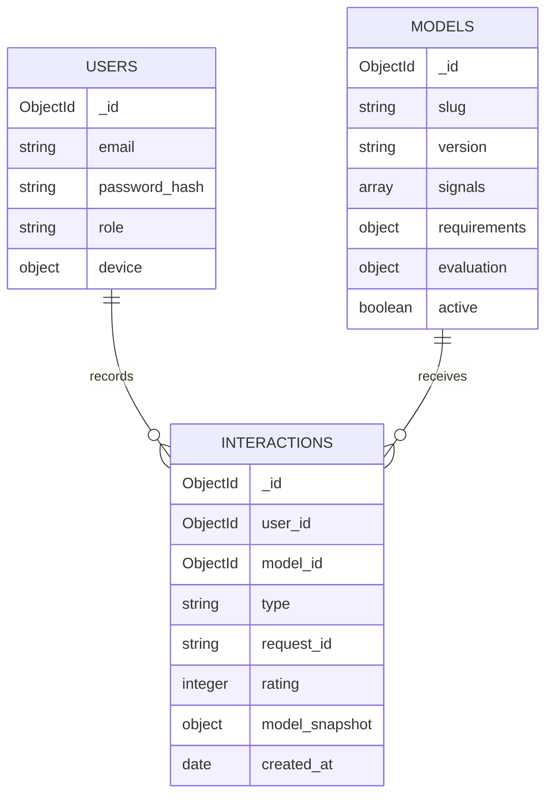

# Data model and query design

## Предметная область

Пользователь выбирает метод детекции сонливости для анализа временных рядов на устройстве
с ограниченными ресурсами. Объект рекомендации — версия модели. Взаимодействие — просмотр,
сохранение, выбор или оценка. Каталог не хранит веса нейросетей и медицинские записи.



## Коллекции и инварианты

### users

`_id`, `email`, `display_name`, `password_hash`, `role`, `device`, `created_at`, `updated_at`.
Email приводится приложением к нижнему регистру и защищён уникальным индексом.
Регистрация всегда создаёт роль `user`; поле `role` в пользовательском запросе запрещено.
Пароль хранится как Argon2id-хеш. API исключает `password_hash` из ответов.

`device` — `null` либо небольшой вложенный документ:

```json
{
  "signal": "eeg",
  "memory_budget_mb": 128,
  "max_latency_ms": 100,
  "reference_device": "synthetic-edge-v1"
}
```

### models

`_id`, `name`, `slug`, `version`, `description`, `category`, `signals`, `tags`,
`requirements`, `evaluation`, `synthetic`, `active`, `created_at`, `updated_at`.
Пара `(slug, version)` уникальна. Новая версия создаётся отдельным объектом.
Категории: `classical_ml`, `deep_learning`, `hybrid`.
Сигналы: `eeg`, `ecg`, `eog`, `imu`, `video_features`.

`requirements`: память в MB, задержка в ms и идентификатор эталонного устройства.
`evaluation`: F1 от 0 до 1, набор данных и протокол проверки. Эти поля нужны, чтобы
в дальнейшем не сравнивать несопоставимые эксперименты. Демо-значения симулированы.
Массивы сигналов и тегов ограничены по размеру и не допускают повторов.

### interactions

`_id`, `user_id`, `model_id`, `type`, `rating`, `request_id`, `model_snapshot`, `created_at`.
В MongoDB идентификаторы хранятся как BSON ObjectId, время — как BSON Date в UTC.
`rating` — целое 1..5 только для события `rating`; для остальных типов — `null`.
`request_id` — UUID, уникальный в пределах пользователя.

Снимок содержит название, slug и версию объекта на момент события. Он позволяет читать
историю без `$lookup` и сохраняет историческое название после редактирования модели.
API проверяет существование пользователя и активной модели. MongoDB не предоставляет
внешние ключи: целостность ссылок обеспечивается приложением и политикой архивирования.
Прямые записи в БД через административный доступ должны соблюдать тот же контракт.

## Почему вложения и ссылки используются вместе

Профиль устройства, требования и оценка модели малы, ограничены и обычно читаются вместе
с родителем — они вложены. История постоянно растёт и связывает пользователей с моделями,
поэтому хранится отдельно. Это предотвращает разрастание пользовательского документа,
снижает конкуренцию за его обновление и позволяет независимо индексировать события.

Снимок названия в событии — осознанная денормализация: немного дополнительного места
в обмен на независимое чтение истории. Он не обновляется при изменении каталога.

## Основные запросы и индексы

Во всех коллекциях также существует автоматический индекс `_id_`.

| Запрос / инвариант | Индекс | Обоснование |
|---|---|---|
| Вход и уникальность email | users: `email ASC`, UNIQUE | Точный поиск канонического email |
| Уникальная версия модели | models: `slug ASC, version ASC`, UNIQUE | Один объект на версию |
| Последние активные модели | models: `active ASC, created_at DESC, _id DESC` | Равенство + порядок выдачи |
| Категория и последние модели | models: `active ASC, category ASC, created_at DESC, _id DESC` | Равенства перед полями сортировки |
| Сигнал, устройство и бюджет памяти | models: `active ASC, signals ASC, requirements.reference_device ASC, requirements.memory_mb ASC` | Одно multikey-поле, затем диапазон памяти |
| Поиск по названию, описанию, тегам | models: TEXT(name, description, tags) | Поиск слов; веса 5 / 1 / 3 |
| История пользователя | interactions: `user_id ASC, created_at DESC, _id DESC` | Стабильная курсорная выдача |
| События модели по типу и времени | interactions: `model_id ASC, type ASC, created_at DESC` | Статистика выбранного типа события |
| Идемпотентность | interactions: `user_id ASC, request_id ASC`, UNIQUE | Защита от гонок повторных запросов |
| Активность за период | interactions: `created_at ASC, type ASC` | Ограничение временного диапазона аналитики |

Запрос последних 20 действий:

```javascript
db.interactions.find({user_id: ObjectId("<user-id>")})
  .sort({created_at: -1, _id: -1}).limit(20)
```

Следующая страница ограничивается одновременно пользователем и условием:
`created_at < cursor.time OR (created_at == cursor.time AND _id < cursor.id)`.
Курсор не даёт доступа к чужой истории: фильтр пользователя всегда добавляет сервер.
Это обходится без растущего `skip`; новые записи впереди не сдвигают уже прочитанную границу.

Планы конкретных комбинаций фильтров нужно проверять через `explain`. Индекс бюджета
не покрывает одновременно диапазон задержки и сортировку по задержке: возможны остаточный
фильтр и сортировка. `$text` также не обеспечивает произвольный порядок по времени.
Реализация не обещает, что один индекс ускорит все сочетания фильтров.

## Валидация, согласованность и атомарность

- Pydantic проверяет запросы; `$jsonSchema` повторно проверяет документы внутри MongoDB.
- Во всех трёх коллекциях запрещены неизвестные поля и включён `validationAction=error`.
- Уникальный индекс устраняет гонку проверки повторов: после DuplicateKeyError API
  возвращает исходное событие, если payload совпадает, либо 409 при конфликте.
- `DELETE /models/{id}` устанавливает `active=false`. История и ссылки сохраняются;
  новые события после архивирования отвергаются. Запрос, уже проверивший активность
  перед параллельным архивированием, может завершиться — это допустимая граница контракта.
- Счётчики и рейтинги вычисляются агрегациями. Не нужно синхронно менять несколько
  документов при каждом событии; каждая запись события атомарна сама по себе.
- Multi-document transactions не добавлены без необходимости. При появлении строгих
  связанных изменений понадобится replica set и отдельное обоснование транзакций.

## Агрегации

Популярность: `$match` по периоду → `$group` по модели → `$lookup` каталога → фильтр активных
моделей → `$sort` → `$limit` → `$project`. События считаются как события, а не уникальные люди.

Рейтинг: отбор `rating` → сортировка по времени и `_id` → последний рейтинг каждого
пользователя для каждой модели → среднее по пользователям → присоединение каталога.
Повторная оценка не увеличивает вес одного пользователя.

Активность: `$match` по периоду и `$facet` с группировкой по типу и по дню в UTC.
Полный подсчёт рейтингов читает релевантные события; при большом потоке отдельным этапом
можно добавить материализованное представление последних оценок.

## Сравнение NoSQL-моделей

| Модель | Польза для этой задачи | Компромисс |
|---|---|---|
| Документная / MongoDB | Вложенные характеристики, фильтры каталога, индексы и агрегации | Ссылки контролирует приложение; индексы занимают место и замедляют запись |
| Ключ-значение / Redis | Быстрые обращения по ключу, кэш готовых рекомендаций | Для выбранной схемы потребовалось бы отдельно проектировать каталожные запросы и аналитику; возможности зависят от модулей |
| Графовая / Neo4j | Обход связей user–model для будущего collaborative filtering | В текущем наборе преобладают фильтры документов и временная история, а не обход графа |

По текущему набору запросов выбрана MongoDB. Redis и Neo4j не добавлены в учебный стек:
дополнительная база увеличила бы число частей без обязательного сценария использования.
Сырые временные ряды пока не хранятся; time-series коллекция не нужна для одного каталога.

## Проверка на данных

`python -m app.manage benchmark` сравнивает один запрос с `hint({$natural:1})` и с
`hint("user_recent")`, не удаляя индексы. На 100 000 событиях план COLLSCAN + SORT
просмотрел 100 000 документов, IXSCAN + FETCH + LIMIT — 20. Совпадение результатов
проверяется по всем 20 идентификаторам. Подробности: `verification.md` и исходный JSON.

## Источники

- [MongoDB Data Modeling](https://www.mongodb.com/docs/manual/data-modeling/)
- [Schema Validation](https://www.mongodb.com/docs/manual/core/schema-validation/)
- [PyMongo Indexes](https://www.mongodb.com/docs/languages/python/pymongo-driver/current/indexes/)
- [Explain Results](https://www.mongodb.com/docs/manual/reference/explain-results/)
- [Aggregation Operations](https://www.mongodb.com/docs/manual/aggregation/)
